# System Architecture — `miter`

> **Crates:** `miter-cli`, `miter-engine`, `miter-ast`, `miter-storage`, `miter-harness`, `miter-mcp`  
> **Storage Backend:** Embedded `redb` B-Tree Key-Value Database (`.miter/miter.redb`)  
> **Concurrency:** Multi-Reader Single-Writer Process Locking

---

## 1. System Overview & Dataflow

`miter` is an autonomous AST co-processor and compiler verification engine. It parses polyglot source trees into content-addressed symbols, tracks references and blast radii, audits module size ceilings, scrubs secrets from code artifacts, and runs ephemeral worktree compilation checks.

```mermaid
flowchart TD
    subgraph Ingestion["1. Ingestion & AST Extraction"]
        SRC["Polyglot Source Tree\n(13 Code, Config & Doc Formats)"] --> DISP["polyglot::dispatch"]
        DISP -->|Rust, TS, Python| AST["miter-ast (Tree-sitter)"]
        DISP -->|SQL, Docker, K8s, Env| EXT["Declarative Extractors"]
        AST --> SCRUB["Secret Redaction Scrubber"]
        EXT --> SCRUB
    end

    subgraph Storage["2. Storage & Codec"]
        SCRUB --> CODEC["Binary Persistence Codec\n(MITER Magic + LE Records)"]
        CODEC --> REDB["miter-storage (redb)\n(.miter/miter.redb)"]
    end

    subgraph Analysis["3. Deterministic Analysis Engine (miter-engine)"]
        REDB --> HYD["Hydration & Skeletons"]
        REDB --> IMP["Impact & Blast Radius (Reverse BFS)"]
        REDB --> SLC["Slice & Clustering (Dependency Seams)"]
        REDB --> CNT["Cross-Language Contracts (SQL/Rust/TS)"]
        REDB --> AUD["Line-Count & Tarjan Cycle Audits"]
    end

    subgraph Verification["4. Compiler Verification (miter-harness)"]
        H_REQ["Verify Request"] --> WT["Ephemeral Git Worktree\n(.git/worktrees/miter-*)"]
        WT --> CMP["Compiler Subprocess\n(cargo check / tsc)"]
        CMP --> DIAG["Diagnostic JSON Parser"]
        DIAG --> WT_DEL["Worktree Teardown"]
    end

    subgraph Entrypoints["5. Process Interfaces"]
        HYD --> CLI["miter-cli (Terminal / JSON)"]
        IMP --> CLI
        SLC --> CLI
        CNT --> CLI
        AUD --> CLI
        DIAG --> CLI

        HYD --> MCP["miter-mcp (JSON-RPC 2.0 Stdio)"]
        IMP --> MCP
        SLC --> MCP
        CNT --> MCP
        AUD --> MCP
        DIAG --> MCP
    end
```



---

## 2. Storage & Redb Schema Architecture

The persistent index is housed in a single file at `.miter/miter.redb` within the repository root (or pointed to via `--db <PATH>`). `redb` provides ACID MVCC transactions with zero external server dependencies:

```text
.miter/
└── miter.redb                 # Embedded redb B-Tree storage
    ├── symbols                # Key: u64 (FNV-1a64) -> Value: Encoded FunctionSymbol record
    ├── references             # Key: u64 -> Value: List of referencing symbol IDs
    ├── files                  # Key: String (relative path) -> Value: FileMetadata & hashes
    ├── contracts              # Key: String (canonical entity name) -> Value: PolyglotEntity
    └── ledger                 # Key: String (file path) -> Value: Blake3 SHA-256 hash
```

### Binary Record Layout (`codec::VERSION = 1`)

```text
┌────────────────┬──────────────┬──────────────┬──────────────┬───────────────────┐
│ Magic (5 bytes)│ Version (1B) │ Symbol ID    │ Hierarchy Lvl│ Length-Prefixed   │
│ "MITER"        │ 0x01         │ (8 bytes LE) │ (1 byte LE)  │ UTF-8 Identifiers │
└────────────────┴──────────────┴──────────────┴──────────────┴───────────────────┘
```

---

## 3. Crate & Package Topology

### `miter-ast`
- **Path:** `crates/ast_indexer`
- **Role:** Pure syntax parsing with Tree-sitter. Maps Rust, TypeScript, TSX, JavaScript, and Python into raw `FunctionSymbol` declarations with hierarchy depths (`0..=4`). Contains zero storage logic and zero network code.

### `miter-engine`
- **Path:** `crates/engine`
- **Role:** Analysis engine and domain models. Owns secret scrubbing, symbol hydration neighbour sorting, Tarjan SCC cycle detection, SimHash clone clustering, polyglot contract verification, and file line-count audits.

### `miter-storage`
- **Path:** `crates/storage`
- **Role:** Embedded `redb` lifecycle manager. Owns schema versioning (`ENGINE_STORAGE_VERSION`), database initialization, lock contention handling, and automatic auto-purge recovery when corruption is encountered.

### `miter-harness`
- **Path:** `crates/harness`
- **Role:** Compiler verification harness. Spawns sandboxed git worktrees (`git worktree add --detach`), applies candidate patches in isolation, executes target compilers (`cargo check`, `tsc --noEmit`), parses stderr diagnostic streams, and guarantees cleanup.

### `miter-mcp`
- **Path:** `crates/mcp`
- **Role:** Model Context Protocol (JSON-RPC 2.0 over stdin/stdout) stdio adapter. Exposes `miter_lookup`, `miter_skeleton`, `miter_references`, `miter_impact`, `miter_slice`, `miter_audit`, and `miter_verify` to AI agents.

### `miter-cli`
- **Path:** Root package (`src/`)
- **Role:** Command-line binary facade. Dispatches CLI subcommands, handles terminal table rendering or `--json` structured formatting, and manages process exit codes.
