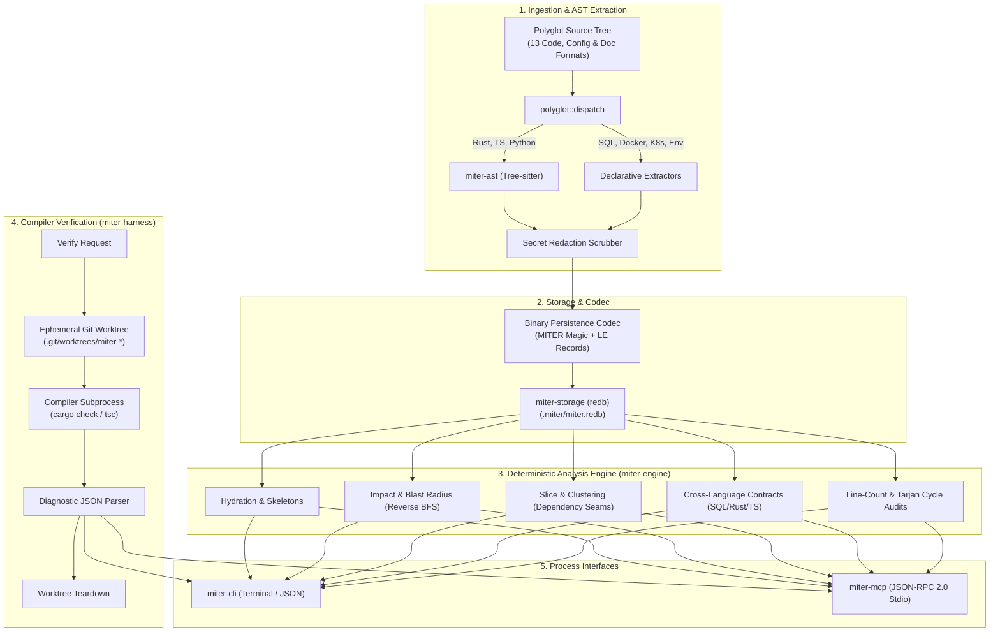

# System Architecture — `miter`

> **Crates:** `miter-cli`, `miter-engine`, `miter-ast`, `miter-storage`, `miter-harness`, `miter-mcp`,
> `miter-polyglot`, `miter-security`, `miter-analysis`, `miter-inventory`
> **Storage Backend:** Embedded `redb` B-Tree Key-Value Database (`.miter/miter.redb`)  
> **Concurrency:** Multi-Reader Single-Writer Process Locking

---

## 1. System Overview & Dataflow

`miter` is an autonomous AST co-processor and compiler verification engine. It parses polyglot source trees into content-addressed symbols, tracks references and blast radii, audits module size ceilings, scrubs secrets from code artifacts, and runs ephemeral worktree compilation checks.



---

## 2. Storage & Redb Schema Architecture

The persistent index is housed in a single file at `.miter/miter.redb` within the repository root (or pointed to via `--db <PATH>`). `redb` provides ACID MVCC transactions with zero external server dependencies:

```text
.miter/
└── miter.redb                 # Embedded redb B-Tree storage
    ├── symbols                # Key: u64 (FNV-1a64) -> Value: Encoded FunctionSymbol record
    ├── references             # Key: u64 -> Value: List of referencing symbol IDs
    ├── files                  # Key: String (relative path) -> Value: FileMetadata & hashes
    ├── contracts              # Key: String (canonical entity name) -> Value: PolyglotEntity
    └── ledger                 # Key: String (file path) -> Value: Blake3 SHA-256 hash
```

### Binary Record Layout (`codec::VERSION = 1`)

```text
┌────────────────┬──────────────┬──────────────┬──────────────┬───────────────────┐
│ Magic (5 bytes)│ Version (1B) │ Symbol ID    │ Hierarchy Lvl│ Length-Prefixed   │
│ "MITER"        │ 0x01         │ (8 bytes LE) │ (1 byte LE)  │ UTF-8 Identifiers │
└────────────────┴──────────────┴──────────────┴──────────────┴───────────────────┘
```

---

## 3. Crate & Package Topology

### `miter-ast`
- **Path:** `crates/ast_indexer`
- **Role:** Pure syntax parsing with Tree-sitter. Maps Rust, TypeScript, TSX, JavaScript, and Python into raw `FunctionSymbol` declarations with hierarchy depths (`0..=4`). Contains zero storage logic and zero network code.

### `miter-engine`
- **Path:** `crates/engine`
- **Role:** Analysis engine and domain models. Owns secret scrubbing, symbol hydration neighbour sorting, Tarjan SCC cycle detection, SimHash clone clustering, polyglot contract verification, and file line-count audits.

### `miter-polyglot`, `miter-analysis`

Extracted from `miter-engine` in `GB-203`, in dependency order. `miter-engine` re-exports each one
under its original module path, so no caller changed a line.

| Crate | Owns | Depends on |
|:--|:--|:--|
| `miter-polyglot` | the universal symbol model and every language reader | contracts, ast, tree-sitter, sqlparser, hcl, dockerfile-parser, serde_yaml |
| `miter-analysis` | pure passes: clones, references, skeletons, slices, clusters, dependency graphs | polyglot, gaugeblock-inventory, gaugeblock-security, storage (schema types only) |

Two of the four crates that `GB-203` split out have since left this repository, because two other
products needed them and neither depended on miter to provide them:

| Crate | Left for | Why |
|:--|:--|:--|
| `miter-security` → `gaugeblock-security` | `common` (`GB-158`) | std-only redaction, needed by joiner and rabbet, which had no business linking an AST engine for it |
| `miter-inventory` → `gaugeblock-inventory` | `common` (`GB-204`) | Cargo/clap/public-type/git introspection read by chalkline's docs engine and benchwork's docs service; its only dependencies were `gaugeblock-git`, serde and toml |

`miter-polyglot` deliberately stays: it constructs `miter_ast::AstIndexer`, `FunctionSymbol`,
`FunctionNode` and `Param`, so moving it under `common` would put a foundation crate on top of a miter
domain crate. `GB-246` extracts that vocabulary first.

Two boundaries were set by measurement rather than by taste, and both are recorded in
`.gaugeblock/storypole/plans/GB-203.md`:

- **Storage-coupled passes stay in the engine.** Contracts, cycles, hygiene, impact and the dirty ingest
  read the redb tables through the engine's `persist`, which is coupled to `codec`. They are not
  wrappers around pure cores; they walk the store.
- **`audit` stays too.** It calls `config::MiterConfig::load_from_workspace`, and `config` reads the
  workspace root, so extracting audit would put engine config inside a crate the engine depends on.

### `miter-storage`
- **Path:** `crates/storage`
- **Role:** Embedded `redb` lifecycle manager. Owns schema versioning (`ENGINE_STORAGE_VERSION`), database initialization, lock contention handling, and automatic auto-purge recovery when corruption is encountered.

### `miter-harness`
- **Path:** `crates/harness`
- **Role:** Compiler verification harness. Spawns sandboxed git worktrees (`git worktree add --detach`), applies candidate patches in isolation, executes target compilers (`cargo check`, `tsc --noEmit`), parses stderr diagnostic streams, and guarantees cleanup.

### `miter-mcp`
- **Path:** `crates/mcp`
- **Role:** Model Context Protocol (JSON-RPC 2.0 over stdin/stdout) stdio adapter. Exposes `miter_lookup`, `miter_skeleton`, `miter_references`, `miter_impact`, `miter_slice`, `miter_audit`, and `miter_verify` to AI agents.

### `miter-cli`
- **Path:** Root package (`src/`)
- **Role:** Command-line binary facade. Dispatches CLI subcommands, handles terminal table rendering or `--json` structured formatting, and manages process exit codes.

## 4. Reading the crate graph in plain language

Written because the layer model decided a great deal of work and was explained only in terms of
itself. No jargon below that is not defined on the spot.

**Every crate sits on a floor.**

| Floor | Who | What it means |
|:--|:--|:--|
| `foundation` | `gaugeblock-*` | Nothing product-specific. Anyone may use it; it uses no product. |
| `domain` | `*-core`, `*-engine` | One product's substance. |
| `orchestrator` | `joiner-core`, `benchwork-core` | A product whose *job* is running other products. |
| `integrator` | `*-cli`, `*-mcp`, bare names | The way in: binaries, protocol adapters, facades. |

**An edge is one crate using another, and only the direction matters.**

- **Downward** (a higher floor uses a lower one): normal. A product may use infrastructure. 139 of
these exist and nobody has to approve them.
- **Lateral** (same floor, different products): **debt**. Two products are welded together, so neither
can be released, tested or extracted without the other. Four exist, and each needs a ticket in
`.gaugeblock/miter/layers-allowlist.toml`. That file is not a wish list; it is the list of couplings we
have agreed to live with, each with an owner.
- **Upward** (a lower floor uses a higher one): **never allowed, never allowlisted.** Infrastructure that
needs a product cannot exist on its own, and a product core that needs a binary cannot be tested
without it. Zero exist.

**An inversion is the fix for a lateral or upward edge.** Instead of A calling B directly, A declares
the small interface it needs, and something above both plugs B into it. Cost: one interface and one
adapter. Benefit: A no longer needs B to compile, so A can be built, tested and released alone. That
is the whole point - it is about the right to be independent, not about tidiness.

**The gate** is `miter deps --layers --check`. It fails the build when a new lateral edge appears
without a ticket, or when any upward edge appears. Debt therefore cannot grow silently; it can only
grow through a reviewed edit to the allowlist.

**Why it is worth the trouble, in one sentence:** a lateral edge means the tools are no longer
separately usable, and that is the one property that makes this a suite rather than one large
program.

### What the gate does *not* protect

The layer gate protects interoperability: it forbids hidden coupling. It says nothing about whether a
single repository can still be used on its own - a tool can pass every layer check and still be
impossible to build from a clean checkout, which is exactly the state `gaugeblock-workspace` and
`gaugeblock-security` were in until they were published. That is `GB-254`'s standalone-build gate.
Two guards, two properties; passing one does not imply the other.
