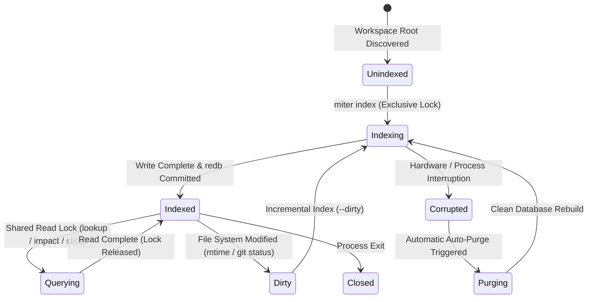
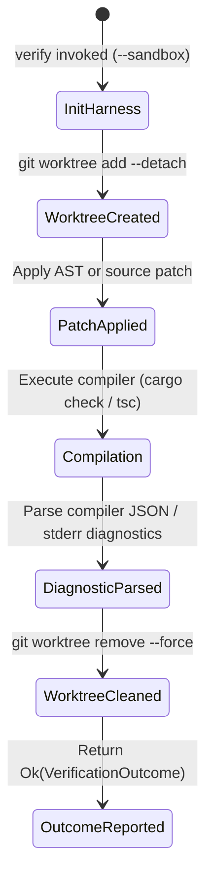

# Behavioral Specifications & Invariants — `miter`

> **Crates:** `miter-cli`, `miter-engine`, `miter-ast`, `miter-storage`, `miter-harness`, `miter-mcp`  
> **Schema Version:** `ENGINE_STORAGE_VERSION = 1`  
> **Protocol:** JSON-RPC 2.0 over Stdio | Embedded `redb`

---

## 1. Behavioral Invariants

### Invariant 1: Pure Content-Addressed Determinism
* Symbol identifiers are 64-bit content-addressed hashes: `fnv1a64(path:line:name) | 1` via `seed_from_text`.
* Symbols occupy syntax hierarchy levels from `0` (top-level module) to `4` (nested local closure/expression).
* Neighbour ranking for hydration is strictly total-ordered:
  1. Depth closeness to the anchor symbol.
  2. Name affinity (shared prefix/suffix tokens).
  3. Physical line distance within the file.
  4. Content-addressed 64-bit identifier tie-breaker.
* No clock time, RNG, or network socket access may influence indexing or analysis outputs.

### Invariant 2: Two-Phase AST Secret Scrubbing
* Secret scrubbing operates at two physical process boundaries:
  1. Ingestion: String literals, environment values, and tokens matching credential heuristics (`sk_live_...`, `ghp_...`, base64 high-entropy blocks) are replaced with `[REDACTED_SECRET]` prior to writing into `redb`.
  2. Egress: Output payloads emitted to CLI stdout or JSON-RPC responses are passed through the token scrubber before write framing.

### Invariant 3: Zero-Panic Persistence & Forward Recovery
* All binary storage records begin with the 5-byte magic `MITER`, followed by a 1-byte schema version, fixed-width integers, and length-prefixed UTF-8 payloads.
* Corrupted records, version mismatches, or malformed magic bytes return strongly typed `DecodeError` or `StorageError` and trigger automatic `.miter/miter.redb` purge recovery rather than panicking.

---

## 2. System State Machines

### 2.1 Database Workspace Lifecycle

### 2.2 Compiler Verification Worktree Sandbox

---

## 3. Formal Type Contracts

### Boundary Models, Wire Types & Enums

- **`impact::AffectedTest`** (`struct`): An affected unit test or integration test detected in the reverse blast radius.
- **`indexer::AstIndexer`** (`struct`): Turns polyglot source code into encoded `FunctionSymbol` records across supported tree-sitter grammars.
- **`slicer::Attention`** (`struct`): AST token attention weighting for candidate modular extraction clusters.
- **`mod::AuditArgs`** (`struct`): Command-line and MCP arguments parsed for the `miter_audit` tool.
- **`audit::AuditConfig`** (`struct`): Configuration options for workspace auditing, including file line ceilings.
- **`audit::AuditFormat`** (`enum`): Serialization choice for `miter audit` (`Table`, `Json`).
- **`audit::AuditSeverity`** (`enum`): Severity classification of a line count or hygiene violation (`Warning`, `Critical`).
- **`config::AuditToolConfig`** (`struct`): Tool-specific configuration for file-length auditing thresholds.
- **`audit::AuditViolation`** (`struct`): A discrete violation flagged during workspace auditing.
- **`mod::CacheStore`** (`struct`): In-memory cache of decoded index entries for accelerated queries.
- **`protocol::CallToolResult`** (`struct`): Standard JSON-RPC MCP payload returned by `tools/call`.
- **`cargo_extractor::CargoExtraction`** (`struct`): Discovered cargo manifests, workspace members, and toolchain config.
- **`args::Cli`** (`struct`): Root command-line parser definition for the `miter` binary.
- **`types::CliArgInventory`** (`struct`): Discovered CLI argument or flag from AST analysis.
- **`types::CliCommandInventory`** (`struct`): Discovered CLI commands and subcommands from AST analysis.
- **`error::CliError`** (`enum`): Failures reported by the CLI, mapped to process exit code 1.
- **`clones::CloneDetectionReport`** (`struct`): Summary report of detected AST structural clones via 128-bit SimHash.
- **`clones::ClonesFormat`** (`enum`): Output format choice for `miter clones` (`Table`, `Json`).
- **`args::Command`** (`enum`): Top-level subcommand variants (`Index`, `Lookup`, `Mcp`, `Audit`, `Slice`, `Skeleton`, `References`, `Impact`, `Contracts`, `Clones`, `Verify`).
- **`tests::Commands`** (`enum`): Test harness CLI subcommand fixture.
- **`contracts::ContractDrift`** (`struct`): Detected discrepancy across SQL, Rust, and TypeScript definitions.
- **`contracts::ContractReport`** (`struct`): Comprehensive multi-language entity schema verification report.
- **`contracts::ContractsFormat`** (`enum`): Output format choice for contract reporting (`Table`, `Json`).
- **`cycles::CycleDetectionReport`** (`struct`): Tarjan SCC file dependency cycle detection report.
- **`mod::DecodeError`** (`enum`): Typed persistence decoder failures (invalid magic, version mismatch, truncated buffer).
- **`lib::EngineError`** (`enum`): Master domain error enumeration for the `miter-engine` analysis pipeline.
- **`contracts::EntityField`** (`struct`): Normalized field contract with canonical type name, nullability, and provenance.
- **`error::HarnessError`** (`enum`): Ephemeral worktree or external compiler subprocess invocation failure.
- **`types::HydrateError`** (`enum`): Symbol hydration failure modes (`NotFound`, `EmptyBudget`, `IndexEmpty`).
- **`hygiene::HygieneReport`** (`struct`): Unused symbols, dead code, and visibility leak analysis report.
- **`lib::IndexError`** (`enum`): File ingestion or tree-sitter parsing failure during indexing.
- **`indexer::IndexReport`** (`struct`): Statistical summary of an ingestion pass (symbols indexed, files parsed).
- **`config::IndexerConfig`** (`struct`): Ingestion configuration (file ignores, max file sizes, extensions).
- **`lib::IngestStats`** (`struct`): Real-time ingestion statistics emitted during parallel repository indexing.
- **`error::InventoryError`** (`enum`): Workspace metadata extraction or manifest parsing errors.
- **`protocol::JsonRpcError`** (`struct`): JSON-RPC 2.0 error response frame.
- **`protocol::JsonRpcRequest`** (`struct`): Inbound JSON-RPC 2.0 request frame.
- **`protocol::JsonRpcResponse`** (`struct`): Outbound JSON-RPC 2.0 success frame.
- **`contracts::MissingFieldDrift`** (`struct`): Specific field present in one language schema but absent in another.
- **`config::MiterConfig`** (`struct`): Workspace `.gaugeblock/config.toml` `[miter]` configuration block.
- **`mod::PersistError`** (`enum`): Failure writing or committing transactions to `redb`.
- **`contracts::PolyglotEntity`** (`struct`): Multi-language entity mapping aggregating SQL, Rust, and TypeScript definitions.
- **`error::PolyglotError`** (`enum`): Syntax extraction or parser failure in polyglot format modules.
- **`tests::Status`** (`enum`): Test harness status enum fixture.
- **`error::StorageError`** (`enum`): Underlying `redb` database lock collision, corruption, or I/O failure.
- **`slicer::UserConfig`** (`struct`): User preferences for AST slicing and decomposition cluster sizes.
